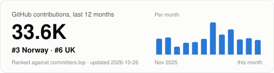

# Hi there, I'm Jostein Svendsen 👋

## 🚀 About Me

**Serial Tech Founder** with extensive experience building and scaling innovative companies across **HealthTech**, **Fintech**, and **AI** sectors. Currently transforming healthcare as Founder of **[Norvana](https://www.norvana.ai)** - an AI-powered comprehensive health platform.

### 🏢 Entrepreneurial Journey

- 🏥 **Healthcare Tech**: Founded Norvana - AI-powered health platform unifying 18+ wearable devices
- 💰 **Fintech**: Built and scaled financial technology companies with global reach
- 🚀 **Multiple Exits**: Track record of building companies from 0 to 1 across multiple sectors
- 🌍 **Trans-Atlantic Experience**: Founded and operated companies in **London**, **Palo Alto**, and across Europe
- 🤖 **AI Pioneer**: Early adopter and implementer of AI/ML in healthcare and financial services

### 🎯 Expertise

- 💼 **Startup Leadership**: Taking ideas from concept to market-ready products
- 🏗️ **Product Development**: Building scalable, multi-platform applications
- 📊 **Fintech Innovation**: Payment systems, financial data analytics, and regulatory compliance
- 🏥 **HealthTech**: HIPAA- and GDPR-ready systems, medical AI, wearable integration
- 🌐 **Global Operations**: Experience scaling companies across Europe and North America
- 💡 **Thought Leadership**: Speaking and writing on AI's impact on work, healthcare, and society

### 📍 Background

- 🎓 **Education**: BSc in Computer Science
- 🌍 **Languages**: Native Norwegian 🇳🇴 & English 🇬🇧
- 📍 **Based in**: London, UK
- 🔗 **Network**: 7,000+ LinkedIn followers, recognized entrepreneur in tech ecosystem

## 🏆 Companies & Ventures

### Current
**🏥 [Norvana](https://www.norvana.ai)** - Founder & CEO
- AI-powered comprehensive health platform
- 18+ wearable device integrations (Oura, Whoop, Apple Health, Garmin)
- Multi-platform: iOS Native and PWA, Android planned
- Preparing for US launch, currently in private beta
- Built for HIPAA and UK GDPR from day one

### Previous Ventures
**💰 Fintech** - Multiple Companies
- Payment processing and financial infrastructure
- Built systems handling millions in transaction volume
- Regulatory compliance (FCA, PSD2, GDPR)
- Cross-border payment solutions
- Financial data analytics and risk management

**🌍 International Experience**
- Founded and scaled companies in **London**, **Palo Alto**, **Norway**
- Experience with both European and North American markets
- Built distributed teams across multiple time zones
- Navigated complex regulatory environments (FDA, FCA, SEC)

## 💻 Tech Stack

### Languages & Frameworks

### Frontend & Mobile

### Backend & Infrastructure

### Cloud & DevOps

### Fintech & Payments

### AI & ML

## 🏗️ Featured Projects

### 🏥 [Norvana](https://www.norvana.ai)
**AI-Powered Comprehensive Health Platform**
- 18+ wearable device integrations (Oura, Whoop, Apple Health, Garmin)
- Multi-platform: iOS Native (SwiftUI) and PWA (React), Android planned
- Real-time health insights with AI-powered predictions
- FastAPI backend with PostgreSQL + Redis
- Medical document processing with OCR and NLP
- WebSocket real-time updates
- Built for HIPAA and UK GDPR

**Tech Stack**: Python, TypeScript, Swift, React, FastAPI, PostgreSQL, Redis, Docker

### 🤖 [AI Monitor](https://github.com/josteins/aimonitor)
**Multi-Platform AI Usage & Balance Monitor**
- Cross-platform desktop app (Tauri/Rust) and mobile (Flutter)
- Track OpenAI, Anthropic, and OpenRouter API usage
- Real-time balance monitoring
- Optional cloud polling for unified tracking

**Tech Stack**: Rust, Tauri, Flutter, Dart

## 📊 GitHub Activity & Contributions

<!-- rankings:start -->

### 🏁 Contribution ranking

<a href="https://josteins.github.io/josteins/rankings/"><picture><source media="(prefers-color-scheme: dark)" srcset="rankings/card-dark.svg"></picture></a>

Updated weekly · <a href="https://josteins.github.io/josteins/rankings/">full charts</a>

<!-- rankings:end -->

### 💻 Language Distribution

### 📈 Contribution Streak

## 🏆 Development Metrics (Public + Private)

### Code & Contributions
- 💾 **Thousands of commits** across enterprise HealthTech and Fintech platforms
- 🔧 **Multi-platform development**: iOS Native, Android, Web (React/TypeScript), Backend (Python/Rust)
- 🏗️ **Infrastructure as Code**: Docker, Kubernetes, CI/CD pipelines with GitHub Actions
- 📦 **Package management**: Built reusable component libraries and design systems
- 🧪 **Test coverage**: Comprehensive unit, integration, and E2E testing suites

### Architecture & Scale
- 🚀 **Built systems handling**: Millions in transaction volume (Fintech), 18+ device integrations (HealthTech)
- ⚡ **Performance optimization**: Sub-100ms API responses, real-time WebSocket communications
- 🔐 **Security & Compliance**: HIPAA-ready health systems and FCA-regulated fintech, with encryption at rest and in transit
- 🌍 **Deployment**: Infrastructure in Europe and the US, built for a US-first launch
- 📊 **Database design**: PostgreSQL schemas for medical documents and time-series health data

### Technical Leadership
- 👥 **Team collaboration**: Led distributed engineering teams across multiple time zones
- 📝 **Documentation**: Comprehensive API documentation, architecture decision records
- 🎯 **Code review**: Maintaining high code quality standards and best practices
- 🔄 **Continuous improvement**: Regular refactoring, dependency updates, security patches

## 📝 Recent Writing

- **[Are We Entering a Post-Human World? The Rise of AI and the Changing Nature of Work](https://www.linkedin.com/in/josteinsvendsen/recent-activity/)** (July 2024)
  - Exploring AI's impact on healthcare and work
  - 7,000+ followers on LinkedIn

## 🌱 Currently Working On

- 🏥 Scaling Norvana's AI health platform
- 🤖 Advanced AI clinical assistant with real-time transcription
- 📊 Digital twin simulations for health optimization
- 🧬 DNA + Blood testing integration for longitudinal health tracking
- 🇺🇸 US launch with our first clinical partners

## 💬 Let's Connect

I'm always interested in discussing:
- 🚀 **Entrepreneurship & Startups**: Building companies from 0 to 1, fundraising, scaling strategies
- 💰 **Fintech Innovation**: Payment systems, financial infrastructure, regulatory compliance
- 🏥 **Healthcare Technology**: AI in medicine, wearables, digital health platforms
- 🤖 **AI & Machine Learning**: Practical AI implementation, LLMs in production, AI safety
- 🌍 **Global Expansion**: Scaling across Europe, North America, and emerging markets
- 💼 **Angel Investing**: Supporting early-stage founders in tech, especially Fintech & HealthTech
- 🎯 **Product Strategy**: Building products that scale, UX/UI for complex systems

### 📫 Reach Out
- 💼 [LinkedIn](https://www.linkedin.com/in/josteinsvendsen) - 7,000+ followers
- 🌐 [Norvana](https://www.norvana.ai) - Current venture
- 🐙 [GitHub](https://github.com/josteins) - Open source projects
- 📧 Open to collaborations, advisory roles, and angel investments

---

**"Serial Tech Founder | Building the Future of Healthcare & Finance"** 🚀

*From Fintech to HealthTech - Transforming industries through innovation*

